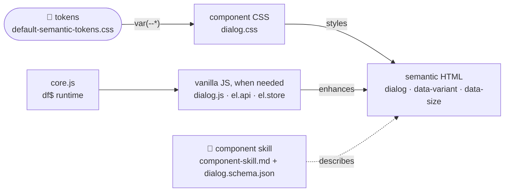
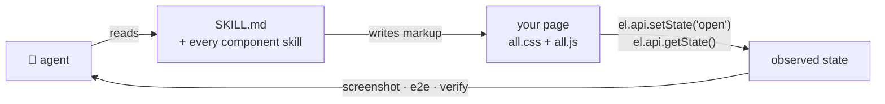

# defuss-shadcn

[](https://github.com/kyr0/defuss-shadcn)
[](LICENSE)


[](https://www.npmjs.com/package/defuss-shadcn)
[](https://www.npmjs.com/package/defuss-shadcn)
[](https://www.npmjs.com/package/defuss-shadcn)
[](https://socket.dev/npm/package/defuss-shadcn)

**A UI component system that scales with AI:** the shadcn/ui look as plain HTML, CSS and vanilla JavaScript, with a skill for every component.

Themeable, stateful components, built on semantic HTML, modern CSS, and vanilla JavaScript. No framework. No build step for consumers - `dist/` is committed and ready to use as-is. A foundation for agentic-first frontend engineering.

**234 components - 64 with JavaScript, 170 CSS-only - 418.0 KiB minified + compressed - 279.8 KiB as the all.css/all.js bundle**
170 of 234 components need no JavaScript - native HTML and modern CSS cover them entirely.
<!-- parity anchor: README ↔ index (AGENTS.md) - the footprint sentence and pillar set must match src/documentation/pages/index.mdx; commit both files together -->
The footprint is measured from the shipped `dist/` files on every build and published as [`dist/stats.json`](dist/stats.json); `verify` fails the build if this sentence and that file disagree.

**[Documentation & Live Demos →](https://shadcn.defuss.org/)** · [Theme Designer](https://shadcn.defuss.org/guides/theme-designer.html) · [Architecture (ARCH.md)](ARCH.md) · [Agent skill (SKILL.md)](skills/defuss-shadcn/SKILL.md)

## TL;DR

A framework component library ties every button to a framework version, a bundler and a build. An AI agent that writes a page then needs all three to see what it wrote, and a server-rendered template, a static site or a plain `.html` file cannot use the components at all.

defuss-shadcn ships the components as files. Tokens are CSS custom properties in the [tweakcn](https://tweakcn.com) shape, every component is one stylesheet plus, where the browser cannot do it alone, one ES module, and every component carries a skill that tells an agent how to write its markup. A page links two files, writes HTML, and is done - in a template engine, a static site, a CDN include or a file opened from disk.

- 🎨 **Themeable** - full shadcn semantic token model. 43 [tweakcn](https://tweakcn.com) presets ship as drop-in theme files - swap one and every component updates instantly; light and dark are two palettes of one identity (the same radius in both, gated)
- 📘 **Component Skills** - every component includes a structured skill - markup, variants, sizes, density, named states, ARIA, and wiring conventions - grounded in web standards; every interactive component also ships a machine-readable `*.schema.json` contract (states, types, defaults, actions) that drives its docs controls and is verifier-enforced; three task skills - `shadcn-plan`, `shadcn-theme`, `shadcn-review` - plan UI from the existing components, write themes and review markup, each with a bundled checker where a program can decide
- 🔁 **Observable state** - interactive components expose a State API (`el.api.setState('open')`, `el.api.getState()`), so agents and tests can drive every documented state by name without knowing the implementation
- ♿ **Accessible** - built on native HTML elements and WAI-ARIA patterns (menus and menubars with nested submenus, tabs, dialogs, trees, comboboxes, one-time-code fields, virtualized lists). Keyboard navigation, focus management, and screen reader support by default
- 🧩 **Standalone HTML** - plain HTML, CSS and ES modules, no framework, no build pipeline; the interactive components run on one tiny core runtime, `df$` - [defuss-query](https://www.npmjs.com/package/defuss-query) (DOM selection and events) and [defuss-morph](https://www.npmjs.com/package/defuss-morph) (HTML reconciling) plus the shared State API helpers, shipped once as `core.js` inside `all.js`

The documentation site dogfoods the CDN install: every demo loads `all.css` / `all.js` and its theme from the jsDelivr CDN, pinned to the release it documents (the index page names that release) - if it renders, the CDN install works.

## How it works

One component is five layers in one folder. The tokens feed the stylesheet, the stylesheet styles semantic HTML, a script enhances that HTML only where the browser has no native behavior, and the skill describes the whole to an agent:



For an agent the same files close a loop: it reads the skill, writes markup against the shipped bundle, drives the result by state name and checks what it sees.



| Surface | When you reach for it | What it does |
|---|---|---|
| **`all.css` + `all.js`** | one page, every component | The generated bundle: the core runtime plus every component's styles and behavior (`.min` twins and source maps ship beside them). The documentation site loads exactly this pair. |
| **`core.css` + `core.js`, then `<name>/<name>.css` + `.js`** | ship only what you use | `core.css` is tokens + sizing + layout + accessibility utilities, `core.js` the `df$` runtime; every component's own files load after them and are independent of each other. |
| **`dist/theme/<preset>.css`** | a different look | One stylesheet with `:root` + `.dark` token blocks, linked after the tokens. 43 tweakcn presets ship generated; your own tweakcn export works the same way. |
| **`data-variant` / `data-size` / `data-density`** | which version of a component | The one attribute API for variants and sizes - `<button class="btn" data-variant="outline">`, never a modifier class. |
| **`el.api` / `el.store`** | drive or observe a component | `setState(name, config)`, `getState()` and `render(state)` by state name on every interactive element, plus a [defuss-store](https://www.npmjs.com/package/defuss-store) of `{ name, config }` to subscribe to; the registry twins live at `df$.shadcn.<name>Api`. |
| **`dist/schemas/<name>.schema.json`** | tooling | The machine contract of a component's states and actions - what drives the State tab of every live example. |
| **`skills/defuss-shadcn/SKILL.md`, `skills/shadcn-*`** | an AI agent | The whole project as one Agent Skill with every component skill beside it, and three task skills: plan, theme, review. |
| **`dist/sections/`, `dist/apps/<app>/`** | a slice of the system | One bundle per sidebar section (also attached to each release as a ZIP) and one lean bundle per application scaffold. |

## Install

### Via CDN

```html
<!-- 1. Add the base: tokens + sizing/layout/accessibility utilities (a theme preset from dist/theme/ may follow) -->
<link rel="stylesheet" href="https://cdn.jsdelivr.net/gh/kyr0/defuss-shadcn@latest/dist/components/core.css">

<!-- 2. Add the icons -->
<script src="https://unpkg.com/lucide@1.8.0"></script>
<script>lucide.createIcons();</script>

<!-- 3a. Everything at once: the bundle (embeds the core runtime) -->
<link rel="stylesheet" href="https://cdn.jsdelivr.net/gh/kyr0/defuss-shadcn@latest/dist/components/all.css">
<script type="module" src="https://cdn.jsdelivr.net/gh/kyr0/defuss-shadcn@latest/dist/components/all.js"></script>

<!-- 3b. …or only the components you use: their CSS, then core.js + their JS -->
<link rel="stylesheet" href="https://cdn.jsdelivr.net/gh/kyr0/defuss-shadcn@latest/dist/components/button/button.css">
<link rel="stylesheet" href="https://cdn.jsdelivr.net/gh/kyr0/defuss-shadcn@latest/dist/components/dialog/dialog.css">
<script type="module" src="https://cdn.jsdelivr.net/gh/kyr0/defuss-shadcn@latest/dist/components/core.js"></script>
<script type="module" src="https://cdn.jsdelivr.net/gh/kyr0/defuss-shadcn@latest/dist/components/dialog/dialog.js"></script>

<!-- 4. Only with the HTML Preview Editor: the extra bundle, after 3a or 3b -->
<link rel="stylesheet" href="https://cdn.jsdelivr.net/gh/kyr0/defuss-shadcn@latest/dist/components/wysiwyg.css">
<script type="module" src="https://cdn.jsdelivr.net/gh/kyr0/defuss-shadcn@latest/dist/components/wysiwyg.js"></script>
```

Two delivery modes, one implementation: **load core plus the components you use, or load all alone.** `core.js` installs the callable `df$` runtime (query + morph + the shared component layer at `df$.shadcn.shared`) - every component `.js` requires it, loaded first; a missing or mismatched core fails with one actionable load-order error before anything renders. Every runtime bundle carries a per-release provenance pointer (bundled upstream versions + license hashes; full notice in `components/NOTICE.txt`). One component is kept out of `all.*`: the HTML Preview Editor (`code-example` - editable source + sandboxed live preview, the card every docs example renders in) ships as the extra bundle `wysiwyg.css` / `wysiwyg.js`, loaded after `all.*` or core. Pin a release instead of `@latest` for production: [Installation → Pinning a version](https://shadcn.defuss.org/introduction/installation.html).

### Via npm

In a project with a package manager and a bundler, install the package and import the same files in the same order from the app entry:

```bash
bun add defuss-shadcn
# or: npm install defuss-shadcn
```

```js
import 'defuss-shadcn/dist/components/core.css'; // tokens + utilities
import 'defuss-shadcn/dist/components/all.css';  // every component's styles
import 'defuss-shadcn/dist/components/all.js';   // df$ runtime + every component's behavior
```

### Self-hosting

Download the full system and drop it into any project. All the files are static - no build step, no dependencies. Point an AI at `dist/SKILL.md` and it has everything it needs: the library's integration guide and philosophy, an index of every component skill (type/why/when/where + supported states), CSS to include, JS to wire up, and the entire documentation site with working examples of every component.

**[Download latest (.zip)](https://github.com/kyr0/defuss-shadcn/archive/refs/heads/main.zip)**

Need less than everything? Every sidebar section also ships as its own bundle in `dist/sections/`, and each release attaches one ZIP per section - see [Bundles & Downloads](https://shadcn.defuss.org/introduction/bundles.html).

## Quick start

One page, one dialog, driven by name - the markup is the [Dialog skill](dist/components/dialog/component-skill.md)'s structure:

```html
<!doctype html>
<html lang="en">
<head>
  <meta charset="UTF-8">
  <link rel="stylesheet" href="https://cdn.jsdelivr.net/gh/kyr0/defuss-shadcn@latest/dist/components/core.css">
  <link rel="stylesheet" href="https://cdn.jsdelivr.net/gh/kyr0/defuss-shadcn@latest/dist/components/all.css">
</head>
<body>
  <!-- 1. Trigger: a Button, variant and size as data attributes -->
  <button class="btn" data-variant="default" data-dialog-trigger="my-dialog" aria-haspopup="dialog">
    Open
  </button>

  <!-- 2. A native <dialog>: showModal(), Escape, ::backdrop and the focus trap come from the browser -->
  <dialog id="my-dialog" class="dialog" role="dialog" aria-modal="true" aria-labelledby="my-dialog-title">
    <div class="dialog-content">
      <div class="dialog-header">
        <h2 class="dialog-title" id="my-dialog-title">Dialog Title</h2>
        <p class="dialog-description">Supporting description.</p>
      </div>
      <div class="dialog-body">
        <!-- Content goes here -->
      </div>
      <div class="dialog-footer">
        <button class="btn" data-variant="outline" data-dialog-close>Cancel</button>
        <button class="btn" data-variant="default">Confirm</button>
      </div>
    </div>
  </dialog>

  <!-- 3. The runtime + every component; dialog.js wires the trigger and binds el.api -->
  <script type="module" src="https://cdn.jsdelivr.net/gh/kyr0/defuss-shadcn@latest/dist/components/all.js"></script>

  <!-- 4. Drive it by state name - the same calls an agent or a test makes -->
  <script type="module">
    const dialog = document.querySelector('#my-dialog');
    dialog.api.setState('open');
    console.log(dialog.api.getState()); // → { name: 'open', config: { ... }, model: { ... } }
  </script>
</body>
</html>
```

Every component page shows this pattern live: [Dialog](https://shadcn.defuss.org/overlays/dialog.html), and every other component in the [sidebar](https://shadcn.defuss.org/).

## Using components

### Data attributes

Components use `data-*` attributes for variants and sizes - one base class says *what* it is, the attributes say *which version*. Flat specificity, one API for every component, and a `class` attribute an agent can read. Guide: [Data Attribute API](https://shadcn.defuss.org/guides/data-attributes.html).

| Attribute | Values (example) | Meaning |
|---|---|---|
| `data-variant` | `default`, `outline`, `ghost`, `destructive` | the visual variant |
| `data-size` | `sm`, `md`, `lg`, `icon` | the size |
| `data-density` | `compact`, `comfortable`, `spacious` | the whitespace policy - gaps and padding scale, type and fixed dimensions stay |
| `data-side`, `data-position`, ... | per component | structural variations where a component has them |

### State API

Every interactive component declares its states by name (`const dialogStates = ['default', 'open']`) and binds them to each element it initializes. Guide: [State API](https://shadcn.defuss.org/guides/state-api.html).

| Member | Type | Description |
|---|---|---|
| `el.api.setState(name, config?)` | `(string, object?) => void` | apply a declared state; an unknown name throws |
| `el.api.getState()` | `() => { name, config, model }` | the current state, its config and the element's authored markup model |
| `el.api.render(state?)` | `(state?) => string` | the markup of a state, a function of state - what `setState` would produce |
| `el.store` | defuss-store `{ name, config }` | the state as a store: writing it applies the state, subscribing follows every change, including the user's clicks and native closes |
| `df$.shadcn.<name>Api`, `df$.shadcn.<name>States` | registry | the same API with the element passed explicitly, and the declared state list |

Every declared state is covered by four artifacts - a screenshot in both color schemes, the doc page, the component skill and an e2e assertion - and `verify` fails the build when one is missing.

### Theming

Tokens are compatible with [tweakcn.com](https://tweakcn.com) theme exports. A theme is one plain stylesheet with `:root` + `.dark` token blocks - switching themes means switching that file. Guide: [Theming](https://shadcn.defuss.org/guides/theming.html).

1. **Ship it at build time** - link a theme file instead of the token file: every [tweakcn](https://tweakcn.com) preset ships generated in [`dist/theme/`](dist/theme/) (`claude.css`, `vercel.css`, ..., 43 presets; regenerated by `bun run build`, gated by `verify`). Or export your own from tweakcn and replace `dist/theme/utils/default-semantic-tokens.css` - components see the same tokens either way.
2. **Switch it at runtime** - the [Theme Switcher](https://shadcn.defuss.org/navigation/theme-switcher.html) component loads/unloads one `<link id="theme-css">` (the theme rides on top of the token file; no JS token objects). That is exactly what the theme picker on the documentation site does.
3. **Design your own** - the [Theme Designer](https://shadcn.defuss.org/guides/theme-designer.html) edits every token live on the whole site, saves custom themes in your browser as you go, and imports / exports them in the tweakcn shape.
4. Everything updates automatically - all components, the doc site, dark mode (each theme file carries both palettes).

### Optional modules

Four standalone stylesheets live beside the token file and are opt-in - no component depends on them, and the token export stays tweakcn-pure:

- [`dist/theme/utils/sizing.css`](dist/theme/utils/sizing.css) - one numeric scale (`w-4` = four base units, `--size-*` aliases, density-aware spacing)
- [`dist/theme/utils/layout.css`](dist/theme/utils/layout.css) - small layout surface (`flex`, `grid`, `stack`, `container`, named `query` boundaries, overflow + text-flow helpers)
- [`dist/theme/utils/accessibility.css`](dist/theme/utils/accessibility.css) - screen-reader-only content (`.sr-only` / `.not-sr-only`, the clip pattern)
- [`dist/theme/utils/shapes.css`](dist/theme/utils/shapes.css) - reusable silhouettes to mix a design up (radius scale, organic / cut / notch / scoop corners, clip-path shapes, section edges, shadow scale + stylized shadows, frames, background patterns)

Load them after the tokens, before component CSS. Docs: [Sizing](https://shadcn.defuss.org/guides/sizing.html) · [Layout](https://shadcn.defuss.org/guides/layout.html) · [Shapes](https://shadcn.defuss.org/guides/shapes.html) · [Accessibility](https://shadcn.defuss.org/guides/accessibility.html)

### The component folder

```
components/
├── core.css              ← the theme base: tokens + sizing + layout + accessibility
├── core.js               ← the runtime: defuss-morph + defuss-query + shared layer
├── all.css               ← generated bundle: every component stylesheet
├── all.js                ← generated bundle: core runtime + every component's behavior
└── dialog/
    ├── component-skill.md    ← structured skill: HTML structure, attributes, ARIA
    ├── dialog.css            ← stylesheet (uses design tokens)
    └── dialog.js             ← interaction behavior (binds to core, when needed)
```

Some components - like Button and Badge - are CSS-only. No JavaScript needed. The full list, with live demos: **[shadcn.defuss.org →](https://shadcn.defuss.org/)**

## For AI agents

[`skills/defuss-shadcn/SKILL.md`](skills/defuss-shadcn/SKILL.md) (shipped in the npm package) packages the whole project as one Agent Skill: the exact install steps for both paths (npm or jsDelivr, no TypeScript for standalone HTML), the include order, the rules to follow, a map of every documentation page (guides + live examples, linked as MDX sources) and an index of all component skills with why/when - generated from the sources on every build. Every component skill is copied into the skill folder itself (`skills/defuss-shadcn/references/components/`), so an agent reads them right next to the SKILL.md in any install - Claude Code plugin, npm, or a skills-CLI copy - instead of searching for them.

Install it into your coding agent:

```bash
# Claude Code (native plugin marketplace)
claude plugin marketplace add kyr0/defuss-shadcn
claude plugin install defuss-shadcn@defuss-shadcn

# Codex, Cursor, Gemini CLI, GitHub Copilot, Windsurf, … (and Claude Code)
npx skills add kyr0/defuss-shadcn --skill defuss-shadcn
```

Three task skills ship next to it (`skills/shadcn-*/`, generated from the release like the SKILL.md) - the defuss-shadcn layer on top of a project's own method such as [defuss-vae](https://github.com/kyr0/defuss-vae), prefixed so they install beside its `plan` and `review`:

| Skill | What it does | Its checker |
|---|---|---|
| **`shadcn-plan`** | plans a page, a frontend or a new component: reusable units first, existing components and variants before new ones, a type (ATM to TPL), tokens, states, APIs, boundaries, docs and examples for each | - |
| **`shadcn-theme`** | writes or updates a theme from text, colours, a design guide or images | `scripts/theme-check.mjs` checks tokens, radius and WCAG contrast and names the nearest passing lightness |
| **`shadcn-review`** | reviews markup or a new component against the guides | `scripts/markup-check.mjs` finds modifier classes, unknown parts, values and tokens, loading mistakes, globals and unnamed icon buttons |

`npx skills add kyr0/defuss-shadcn --skill '*'` installs all four; the Claude Code plugin carries them (`/defuss-shadcn:shadcn-theme`, ...). Per-agent flags, global installs and updates: [Vibe Coding / Agentic Engineering → Install as an AI Agent Skill](https://shadcn.defuss.org/introduction/vibe-coding.html#install-as-an-ai-agent-skill).

## When to use it

The components are files, so the question is where files are at home.

### DO: use it here

- **Server-rendered templates** - Rails, Django, PHP, Go, Hono, any engine: the output is HTML, and the components are HTML
- **Static sites and documentation** - link the bundle, write markup; the documentation site is built exactly this way
- **Agent-generated UI** - the skill ships with the package, the markup is plain HTML, and every state can be driven and observed by name
- **Prototypes without a toolchain** - a `.html` file with two CDN includes renders every component; a tweakcn preset makes it look like your product
- **Islands inside a framework app** - a component initializes itself on any DOM it finds (a `MutationObserver` picks up markup added later) and talks to the rest of the page through `CustomEvent`s and the State API

### DON'T: reach for it here

- **You need framework bindings** - there are no React, Vue or Svelte components; the components are DOM plus CSS, and your framework renders the markup
- **You must support older browsers** - the components rely on `<dialog>`, the `popover` attribute, CSS nesting, `@layer`, `:has()`, CSS anchor positioning and `@starting-style` natively, and ship no polyfills
- **You want a JavaScript theme object** - a theme is a stylesheet; there is no runtime token API beyond linking a different file
- **You need the components to render their own data** - a Table, a Data Grid or a Chart renders the rows you give it; fetching, caching and auth stay with your application

### Key principles

1. **Native web platform first.** Every component starts from a native HTML element or browser API. If the browser can do it, there is no JavaScript for it.

   | Instead of... | We use... |
   |---------------|----------|
   | JS modal with overlay div | `<dialog>` + `showModal()` + `::backdrop` |
   | JS show/hide dropdowns | `popover` API |
   | JS accordion toggle | `<details>` / `<summary>` |
   | JS enter animations | `@starting-style` |
   | Floating UI / Popper.js | CSS anchor positioning |
   | JS class toggling for parent state | `:has()` selector |
   | JS textarea auto-resize | `field-sizing: content` |
   | Sass / Less / PostCSS | Native CSS nesting, `@layer`, container queries |

2. **Token-driven.** Every color, radius, and shadow comes from a CSS custom property in the tweakcn shape - a component may reference nothing else, so a theme swap can leave nothing undefined.
3. **Dark mode automatic.** The token cascade handles it; no overrides per component.
4. **Variants via data attributes.** `data-variant="primary"`, never `btn-primary`.
5. **One runtime, one namespace.** `core.js` installs `df$` once; components keep their public API under `df$.shadcn.*` and never touch `window` - a copy-paste or CDN-shipped system stays collision-free on hosts it does not control.

## Patterns

### Drive and observe a component

```html
<button class="btn" data-tooltip-trigger="my-tip">Hover me</button>
<div class="tooltip" id="my-tip" popover="hint" role="tooltip">Tooltip text</div>

<script type="module">
  const tip = document.querySelector('#my-tip');
  tip.api.setState('visible');                 // the Tooltip's declared states: default, visible
  tip.api.getState().name;                     // 'visible'
  df$.shadcn.tooltipApi.setState(tip, 'default'); // the registry twin, element passed explicitly
</script>
```

### Switch the theme at runtime

```html
<!-- the tokens, then one theme link the Theme Switcher (or your code) swaps -->
<link rel="stylesheet" id="tokens-css" href="https://cdn.jsdelivr.net/gh/kyr0/defuss-shadcn@latest/dist/theme/utils/default-semantic-tokens.css">
<link rel="stylesheet" id="theme-css" href="https://cdn.jsdelivr.net/gh/kyr0/defuss-shadcn@latest/dist/theme/claude.css">

<script type="module">
  // a theme is a file: swapping the href restyles every component, light and dark
  document.querySelector('#theme-css').href = 'https://cdn.jsdelivr.net/gh/kyr0/defuss-shadcn@latest/dist/theme/vercel.css';
</script>
```

### Ship only what you use

```html
<link rel="stylesheet" href="https://cdn.jsdelivr.net/gh/kyr0/defuss-shadcn@latest/dist/components/core.css">
<link rel="stylesheet" href="https://cdn.jsdelivr.net/gh/kyr0/defuss-shadcn@latest/dist/components/button/button.css">
<link rel="stylesheet" href="https://cdn.jsdelivr.net/gh/kyr0/defuss-shadcn@latest/dist/components/tooltip/tooltip.css">
<script type="module" src="https://cdn.jsdelivr.net/gh/kyr0/defuss-shadcn@latest/dist/components/core.js"></script>
<script type="module" src="https://cdn.jsdelivr.net/gh/kyr0/defuss-shadcn@latest/dist/components/tooltip/tooltip.js"></script>
```

Button is CSS-only, so it has no script; Tooltip's script binds to the `df$` runtime `core.js` installed before it. A whole sidebar section at once: the `dist/sections/<section>.css` + `.js` pair, loaded after `core.*`.

## What "verified" means

The build step exists for maintainers and coding agents only - `dist/` is committed, dependency-free and usable without building anything. The toolchain exists so an agent can **prove** a change instead of trusting it, and every claim in this README is backed by a check you can run:

- `bun run verify` - the static consistency gate, run at the end of every build and the contract every coding agent must satisfy. Among others it checks **structure** (component skills, doc pages, the bundle includes on every page, sidebar links, `dist/` 1:1 with `src/`, the `docs/` release snapshot pinned to its tag), **consistency** (inline source listings match the real files, skill ↔ docs ↔ CSS variant parity, State API contract + per-state coverage across screenshots/docs/skill/e2e, schema ↔ docs state tables, changelog & version sites, every `bun run` / `make` quoted in the docs exists, `dist/stats.json` freshness and the footprint claim above), **quality** (the token boundary rule, undefined utility classes, `prefers-reduced-motion` coverage, init idempotency, dead links, portable paths, strict typecheck, render drift, theme sidebar contrast at WCAG AA in both modes) and **hygiene** (working tree committed - a green build is a committed build). Every failing check prints the offending files **and the exact fix**, so an agent iterates `edit → build → do what it says`.
- `bun run test:run` - the unit suite in headless Chromium (Vitest browser mode + Playwright, no mocks): the real documentation pages from `dist/documentation/` in a same-origin iframe (the statically rendered chrome, the SPA router, dark mode, dialogs, accordions) plus the contract tests of the schema validator, the skill parser and the stats; the totals of the last full run are recorded in [`src/documentation/data/unit-tests.json`](src/documentation/data/unit-tests.json)
- `bun run e2e` - one Playwright smoke test per component in [`tests/e2e/<section>/`](tests/e2e/), the folder of its sidebar section: a fixture page using the component in **every** documented configuration (variant, size, State API state), asserted against the unmodified files in `dist/` - "it compiles" is never mistaken for "it works". The site itself is covered too ([`tests/e2e/site/`](tests/e2e/site/)). The runner fingerprints inputs and reruns only what changed; `bun run e2e --all` runs everything
- `bun run screenshots` - every component and every named state rendered to `screenshots/{light,dark}/`, so an agent can *look* at what it changed; a content-hash manifest re-shoots only what changed
- `bun run typecheck` - component sources and the whole test tree are TypeScript; the build strips types to plain JS (`noCheck`, see [`tsconfig.json`](tsconfig.json)), so what ships is still zero-dependency vanilla JS
- `make build` - the whole pipeline: lint → compile → bundle → minify → stats → docs → screenshots → docs-mirror → verify → tests → e2e

```bash
bun install        # install dev dependencies (make setup also installs Playwright's Chromium)
bun run build      # compile src/ → dist/ (TypeScript → JS, 1:1 copy, all.css/all.js bundle, docs site)
bun run dev        # doc site at http://localhost:3000/
bun run test:run   # the unit suite (headless Chromium)
bun run e2e        # the per-component smoke tests
```

`src/` is the authoring tree (component `.ts`/css/md in the folder of their sidebar section, plus the docs' MDX pages + TSX components rendered by [defuss-ssg](https://github.com/kyr0/defuss)); `dist/` is the compiled output, committed and the only thing that ships. `docs/` is the **release snapshot** of the documentation site that GitHub Pages publishes - its asset references are rewritten to the jsDelivr CDN, pinned to the released tag ([scripts/lib/mirror.ts](scripts/lib/mirror.ts)), so `docs/` carries no copies of the component assets; `bun run docs` refreshes it only on a version change. How this scales without human review, and the proof-loop diagram, are documented in [ARCH.md](ARCH.md); the maintainer rules in [AGENTS.md](AGENTS.md).

### Deliberate limits

No framework bindings, no polyfills for the native APIs the components build on, no runtime theme API beyond a stylesheet, no data fetching inside components, no SSR helpers beyond pasting HTML. The documentation site is a release snapshot: a page merged between releases goes live with the next release. The interactive components require `core.js` (or `all.js`) loaded before them, and the one component outside `all.*` - the HTML Preview Editor - ships as its own bundle. Release history lives in the [Changelog](https://shadcn.defuss.org/introduction/changelog.html).

## Requirements

- **Browsers** - current evergreen Chromium, Firefox and Safari: the components use `<dialog>`, `popover`, CSS nesting, `@layer`, `:has()`, CSS anchor positioning and `@starting-style` natively (guide: [Native Web APIs](https://shadcn.defuss.org/guides/native-web-apis.html))
- **Consumers** - nothing else: no runtime dependencies, no build step; `lucide` is the only optional third-party script, for the icons
- **Maintainers** - [Bun](https://bun.sh) 1.x for every script and the tests, Node.js for the docs renderer (`bun run build` invokes defuss-ssg under node), Playwright's Chromium for the unit suite, the e2e tests and the screenshots

## Citation

If you use defuss-shadcn in research or want to reference it, cite it as:

```bibtex
@misc{homberg2026defussshadcn,
  author       = {Homberg, Aron},
  affiliation  = {Independent Researcher},
  title        = {defuss-shadcn: A Themeable, Skill-Described UI Component System in Semantic HTML, CSS and Vanilla JavaScript},
  year         = {2026},
  version      = {0.9.9},
  howpublished = {\url{https://www.npmjs.com/package/defuss-shadcn}},
  note         = {npm package, MIT License}
}
```

## Credits

This project began as a fork of **[shadcn-html](https://github.com/codylindley/shadcn-html)**; credit to [Cody Lindley](https://github.com/codylindley) for the original idea and first implementation.

Maintained by [Aron Homberg](https://aron-homberg.de) - the TypeScript build chain, State API, and the verifier-driven quality loop ([ARCH.md](ARCH.md)) described above.

## License

Licensed under the [MIT License](LICENSE).
